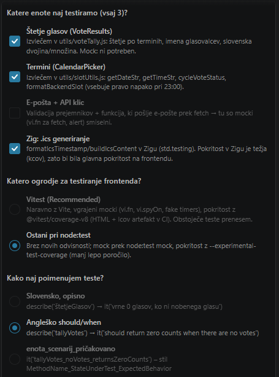
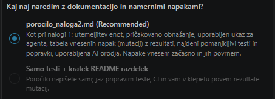

To je bil moj prompt:

V okviru testiranja enot preverjamo posamezne enote ali komponente programske opreme. Gre za zelo pomembno, a pogosto izpuščeno kategorijo testiranja. Namen je validacija vsake enote programske kode, da deluje kot pričakovano. 

Vaša naloga bo, da vašemu projektu dodate teste enot. Teste naj ustvari agent UI, vaša naloga pa je, da poskrbite za njihovo kakovost.

V projektu izberite vsaj tri enote z netrivialno logiko (npr. izračuni, validacije, pogojna logika) in na kratko utemeljite izbiro. Za vsako enoto zapišite, kako bi morala delovati.

Z agentom UI ustvarite teste enot za izbrane enote. V ukazu določite vsaj ogrodje za testiranje, kaj naj testi pokrijejo (običajne primere, robne vrednosti, neveljavne vhode, izjeme), uporabo nadomestnih objektov (mock) in način poimenovanja testov. Teste poženite in preverite, ali testi zaznajo napake. V vsako izbrano enoto namerno vnesite vsaj dve napaki.

Poiščite pomanjkljive teste, na primer teste, ki nič ne preverjajo, pričakovane vrednosti prepisujejo iz trenutnega obnašanja kode, se podvajajo ali so preveč vezani na implementacijo. Teste popravite ali dopolnite (lahko tudi s pomočjo agenta).

Teste enot vključite v ustvarjen cevovod tako, da neuspešen test ustavi izvajanje cevovoda. Poročilo o pokritosti naj bo del rezultatov cevovoda

Oddaja naloge:

Kot rešitev naloge oddajte izvorno kodo ustvarjenih testov. Teste bomo pogledali tudi na vajah. Navedite katera generativna orodija umetne inteligence, vključno z agenti, ste uporabili pri izdelavi naloge.
To so navodila naloge, ki se nanašajo na ta repozitorij. Zastavi mi morebitna potrebna vprašanja, da popolnoma pripraviš ustrezne teste.

Za agenta uporabljam Claude Opus 5.5, na Max naročnini.

Na sliki so vprašanja, ki jih je zastavil Claude.