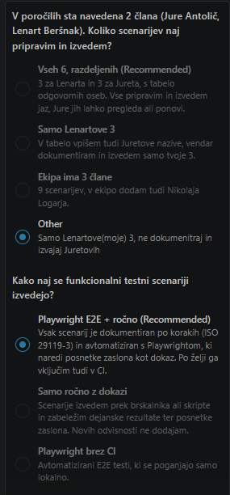
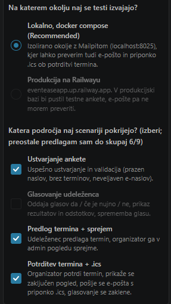

To je bil moj prompt:

Navodilo naloge:

V okviru naloge boste oblikovali in tudi izvedli 3 testne scenarije funkcionalnega testiranja (vsak član ekipe) svoje rešitve.

Najprej preglejte in identificirajte morebitno obstoječo dokumentacijo. V kolikor le ta ne pokriva funkcionalnosti, obnovite ključne funkcionalnosti svoje rešitve. Le to vam bo pomembno pomagalo pri oblikovanju testnih scenarijev.

V skupini se uskladite in izberite vsak 3 testne scenarije (funkcionalne teste), ki jih boste izvedli in zanje pripravili potrebno dokumentacijo. Oblikujete seznam/tabelo iz katere so razvidni nazivi testnih scenarijev in zanj odgovorne osebe.

Priprava testnih scenarijev zahteva strukturiran postopek in doslednost. Obstaja več predlog, predlagam uporabo predloge, kot jo predpisuje 29119-3-2021 - IEEE/ISO/IEC International Standard for Software and systems engineering--Software testing--Part 3:Test documentation | IEEE Standard | IEEE Xplore (do dokumenta imate prosto dostop iz omrežja UM oz. preko elektronskih virov UKM). Predlogo si oblikujete glede na dobre prakse.

Izvedite izbrane scenarije, pri čemer pripravite poročilo testiranja.

Narediva jo po istem postopku kot sva nalogo 2

Za agenta uporabljam Claude Opus 5.5.

Vprašanja, ki jih je zastavil Claude, in moji odgovori:

| Vprašanje | Odgovor |
|---|---|
| Koliko scenarijev naj pripravim in izvedem? | Samo Lenartove (moje) 3, ne dokumentiraj in izvajaj Juretovih |
| Kako naj se funkcionalni testni scenariji izvedejo? | Playwright E2E + ročno |
| Na katerem okolju naj se testi izvajajo? | Lokalno, docker compose |
| Katera področja naj scenariji pokrijejo? | Potrditev termina + .ics, Predlog termina + sprejem, Ustvarjanje ankete |

 

Izseki izvorne kode testov: [testi_naloga3.md](testi_naloga3.md) · Poročilo: [porocilo_naloga3.md](../porocilo_naloga3.md)
