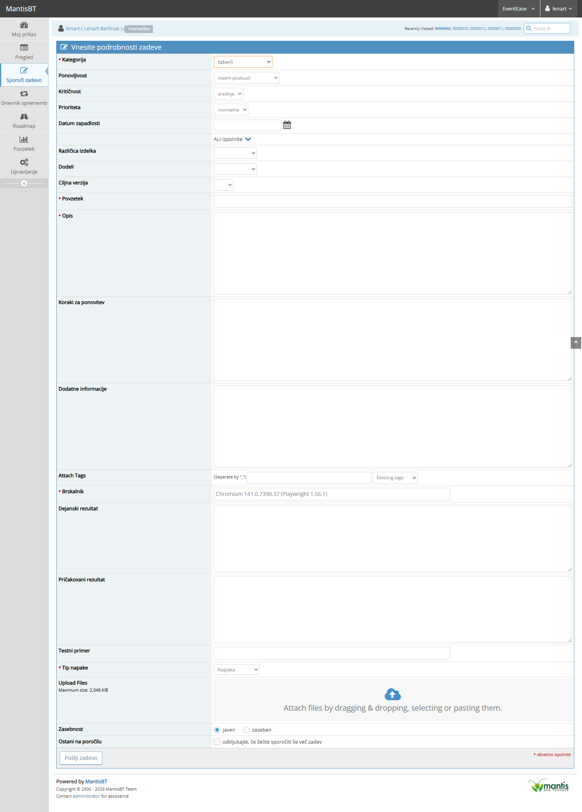
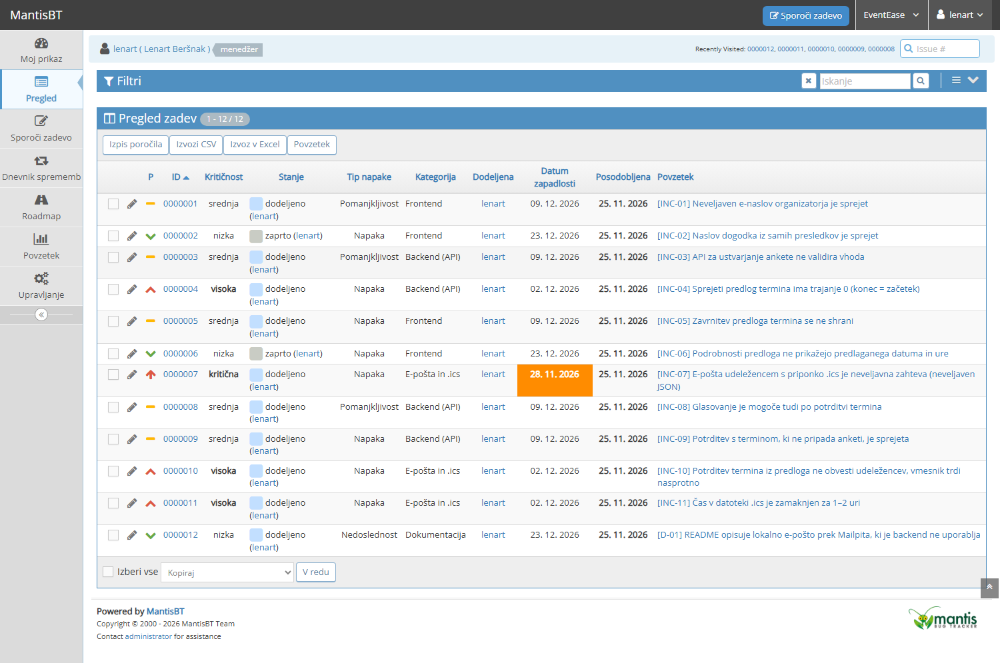

# Poročilo – Naloga 6 (ZK): Upravljanje napak EventEase

**Avtor:** Lenart Beršnak · **Datum:** 25. 11. 2026 · **Scenariji:** TS-L1 … TS-L3 · **Orodje:** MantisBT 2.29.0

**Uporaba UI:** Claude Code (VS Code) z modelom Claude Opus 5.5 (naročnina Max) za postavitev MantisBT v Dockerju, prilagoditev konfiguracije, skripte za vpis in izvoz, popravek dveh napak in osnutek poročila.

## 1. Orodje

**MantisBT** je odprtokodno orodje za sledenje napakam (PHP + MySQL). Izbrali smo ga, ker:
- ga namestimo lokalno ob projektu, tako kot ostala testna okolja (`e2e/`, `load/`),
- ima vgrajena polja, ki jih naloga zahteva (stanje, verzija, platforma/OS, dodeljeni razvijalec, rok, ponovljivost, povezave med napakami, zgodovina sprememb),
- omogoča lastna polja in prilagoditev lestvic v konfiguraciji,
- ima vgrajen izvoz v CSV in Excel ter REST API.

Izbira ni vezana na programski jezik projekta (React, Zig), ker orodje upravlja napake in ne kode.

**Namestitev:** MantisBT 2.29.0 (zip z mantisbt.org) teče v Dockerju: PHP 8.3 + Apache z `mod_rewrite` za REST API in MySQL 8.4 ([napake/compose.yaml](napake/compose.yaml)), na http://localhost:8989. Bazo smo namestili z vgrajenim čarovnikom (`admin/install.php`). Postopek je opisan v [napake/README.md](napake/README.md).

## 2. Prilagoditve

| Zahteva | Rešitev v MantisBT |
|---|---|
| klasifikacija napak | lastno polje **Tip napake** (seznam, obvezno): *Napaka* (funkcionalnost deluje napačno), *Pomanjkljivost* (pričakovano preverjanje ali funkcija manjka), *Nedoslednost* (neskladje med deli sistema ali dokumentacijo) |
| 4 nivoji kritičnosti | lestvica **Kritičnost** skrčena na *nizka, srednja, visoka, kritična* ([config_inc.php](napake/config/config_inc.php), [custom_strings_inc.php](napake/config/custom_strings_inc.php)). Ohranili smo Mantisove številske vrednosti, da pravila, ki temeljijo na resnosti, delujejo naprej. |
| trenutno stanje | vgrajen potek: novo → povratna informacija → sprejeto → potrjeno → dodeljeno → rešeno → zaprto, z **razrešitvijo** (odprto, popravljeno, ne bo popravljeno …) |
| verzija | **Različica izdelka** (kje je napaka najdena: `1.0 (6bad6db)`), **Ciljna verzija** (`1.1`), **Popravljeno v verziji** |
| brskalnik | lastno polje **Brskalnik** (obvezno), npr. `Chromium 141.0.7390.37 (Playwright 1.56.1)` ali »ni vezano na brskalnik« pri napakah API |
| dodatne informacije | lastna polja **Testni primer**, **Pričakovani rezultat**, **Dejanski rezultat**. Vgrajena polja: kategorija (komponenta: Frontend, Backend (API), E-pošta in .ics, Dokumentacija), prioriteta, ponovljivost, platforma/OS (okolje), koraki za ponovitev, dodatne informacije (vzrok v kodi in predlog popravka), dodeljeni razvijalec, **rok**, oznake (scenarij), priloge (posnetek zaslona iz testa), povezave med napakami |

Rok in prioriteta sledita kritičnosti: kritična → takoj, rok 3 dni; visoka → visoka, 1 teden; srednja → normalna, 2 tedna; nizka → nizka, do izdaje 1.1.

## 3. Vpisane napake

Vir so funkcionalni testi naloge 3 ([porocilo_naloga3.md](porocilo_naloga3.md), pogl. 6) in pregled dokumentacije (D-01). Podatki so zbrani v [napake/napake.json](napake/napake.json) in vpisani prek REST API ([vpis.mjs](napake/skripte/vpis.mjs)), zato so vsi zapisi enako popolni.

| # | Oznaka | Povzetek | Tip | Kritičnost | Kategorija | Test | Stanje | Rok |
|---|---|---|---|---|---|---|---|---|
| 1 | INC-01 | Neveljaven e-naslov organizatorja je sprejet | Pomanjkljivost | srednja | Frontend | TC-L1-03 | dodeljeno | 9. 12. |
| 2 | INC-02 | Naslov dogodka iz samih presledkov je sprejet | Napaka | nizka | Frontend | TC-L1-04 | **zaprto** (popravljeno v 1.1) | 23. 12. |
| 3 | INC-03 | API za ustvarjanje ankete ne validira vhoda | Pomanjkljivost | srednja | Backend (API) | TC-L1-05 | dodeljeno | 9. 12. |
| 4 | INC-04 | Sprejeti predlog termina ima trajanje 0 | Napaka | visoka | Backend (API) | TC-L2-03 | dodeljeno | 2. 12. |
| 5 | INC-05 | Zavrnitev predloga termina se ne shrani | Napaka | srednja | Frontend | TC-L2-04 | dodeljeno | 9. 12. |
| 6 | INC-06 | Podrobnosti predloga ne prikažejo datuma in ure | Napaka | nizka | Frontend | TC-L2-05 | **zaprto** (popravljeno v 1.1) | 23. 12. |
| 7 | INC-07 | E-pošta udeležencem z .ics je neveljavna zahteva | Napaka | **kritična** | E-pošta in .ics | TC-L3-03 | dodeljeno | 28. 11. |
| 8 | INC-08 | Glasovanje je mogoče tudi po potrditvi termina | Pomanjkljivost | srednja | Backend (API) | TC-L3-05 | dodeljeno | 9. 12. |
| 9 | INC-09 | Potrditev s terminom druge ankete je sprejeta | Napaka | srednja | Backend (API) | TC-L3-06 | dodeljeno | 9. 12. |
| 10 | INC-10 | Potrditev termina iz predloga ne obvesti udeležencev | Napaka | visoka | E-pošta in .ics | TC-L3-07 | dodeljeno | 2. 12. |
| 11 | INC-11 | Čas v datoteki .ics je zamaknjen za 1–2 uri | Napaka | visoka | E-pošta in .ics | TC-L3-08 | dodeljeno | 2. 12. |
| 12 | D-01 | README opisuje Mailpit, ki ga backend ne uporablja | Nedoslednost | nizka | Dokumentacija | pregled dok. | dodeljeno | 23. 12. |

Skupaj 12 napak: 8 napak, 3 pomanjkljivosti, 1 nedoslednost; 1 kritična, 3 visoke, 5 srednjih, 3 nizke. Vse so dodeljene Lenartu Beršnaku, najdene v verziji `1.0 (6bad6db)`, s ciljno verzijo `1.1`. Povezave: INC-10 je odvisna od INC-04 (vzrok), INC-01 in INC-02 sta povezani z INC-03 (ista validacija na strani strežnika).

Primer celotnega zapisa: [INC-10](napake/dokazi/mantis_2_napaka-INC-10.png).

## 4. Upravljanje: odprava dveh napak

Za prikaz celotnega poteka smo odpravili napaki nizke kritičnosti (commit `4278cae`):

| Napaka | Popravek | Preverjanje |
|---|---|---|
| INC-02 | `CreateEventPage.jsx`: `formData.title.trim()` | TC-L1-04 uspešen brez `test.fail` ([posnetek](napake/dokazi/INC-02_po-popravku_TC-L1-04.png)) |
| INC-06 | `AdminFinalizeView.jsx`: seznam predlogov dobi `start_time`, prikaz »2026-12-12 ob 17:00« | TC-L2-05 (okrepljen, preverja tudi uro) uspešen brez `test.fail` ([posnetek](napake/dokazi/INC-06_po-popravku_TC-L2-05.png)) |

Celoten nabor E2E po popravkih: **18/18 po pričakovanjih**, lint in testi enot (105/105) uspešni ([izpis](napake/e2e-po-popravkih.txt)).

Potek v Mantisu ([odprava.mjs](napake/skripte/odprava.mjs)): **dodeljeno → rešeno** (razrešitev *popravljeno*, popravljeno v verziji *1.1*, opomba s commitom) **→ zaprto** (opomba z rezultatom preverjanja). Vsaka sprememba je v zgodovini zadeve ([posnetek INC-02](napake/dokazi/mantis_3_zaprta-INC-02-zgodovina.png)).

## 5. Izvoz (oddaja)

| Datoteka | Vsebina |
|---|---|
| [napake_eventease.csv](napake/izvoz/napake_eventease.csv) | vgrajeni izvoz CSV (UTF-8), 12 napak, 28 stolpcev (vsa polja iz poglavja 2) |
| [napake_eventease.xml](napake/izvoz/napake_eventease.xml) | vgrajeni izvoz za Excel (SpreadsheetML), enaki stolpci |
| [napake_eventease.json](napake/izvoz/napake_eventease.json) | izvoz prek REST z **opombami, povezavami, prilogami in zgodovino stanj**, ki jih CSV ne vsebuje |

Izvoz ponovimo s `sh skripte/izvoz.sh`, ki zajame vsa stanja (tudi zaprta) in razvrsti po ID.

## 6. Ugotovitve

- Mantis je zahtevam zadostil brez vtičnikov. Dodatno smo nastavili le konfiguracijo (lestvica, polja, izvoz) in pet lastnih polj.
- Opažene posebnosti:
  - Mantisov privzeti filter skrije zaprte napake, izvoz pa uporablja trenutni filter. Brez nastavitve `hide_status_default` bi izvoz izpustil popravljene napake.
  - Vgrajeni CSV ne vsebuje opomb in zgodovine, zato smo dodali izvoz JSON.
  - REST API zahteva `mod_rewrite`, ki ga slika `php:apache` privzeto nima.
- Ker so incidenti iz naloge 3 že imeli koraki, pričakovani in dejanski rezultat ter vzrok, je bil vpis mehanski. Poročila o incidentih v testni dokumentaciji so torej neposredno uporabna kot zapisi v orodju.
- Napaki INC-04 in INC-07 sta najnujnejši: popravek INC-04 odpravi tudi INC-10, INC-07 pa v produkciji onemogoča pošiljanje .ics.
